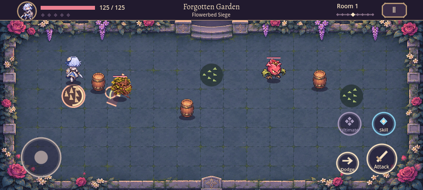
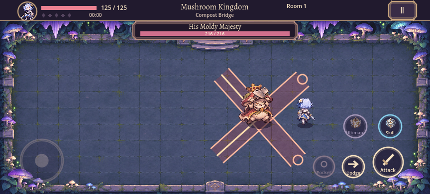
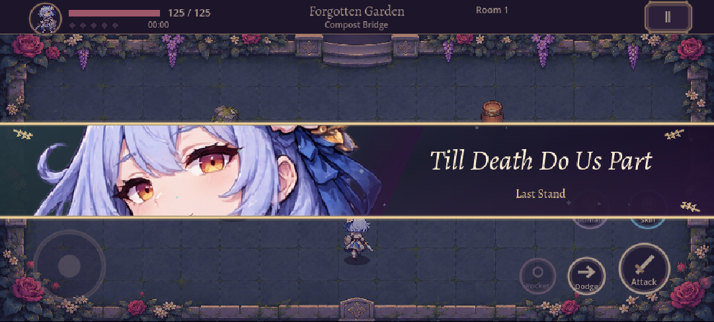
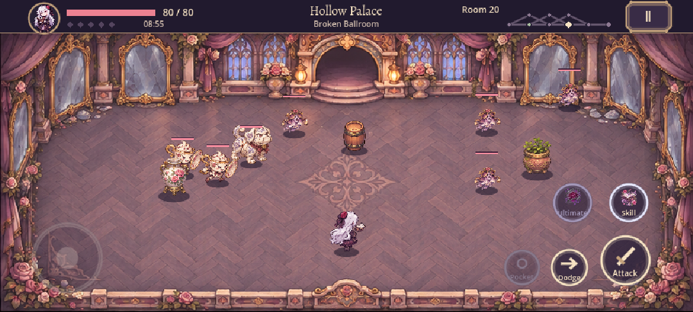

# Garden: Bad Bloom

An offline action roguelike by **Hugo & Angela Works**. Pick a Garden girl, descend into a blighted garden, and build a run out of relics, weapon evolutions, upgrades, and bad decisions.

**Free to win.** Earn Garden Seeds by playing and spend them on items, decorations, game cartridges, and soundtrack tapes.

The 0.1.13 balance pass changes all five heroines and adds four heroine-specific starting relics. See [player checks](docs/PLAYTEST_0.1.13.md).

[Download for Android](https://github.com/hugosyrf/garden-bad-bloom/releases/tag/v0.1.12) · [0.1.12 player notes](docs/PLAYTEST_0.1.12.md)

## Gameplay screenshots

Captured in the running game during development.

| Garden combat | His Moldy Majesty |
| --- | --- |
|  |  |
| **Angela’s ultimate** | **Hollow Palace** |
|  |  |

## Run locally

Open `project.godot` in Godot 4.4.1 and run the project. The Android build uses landscape orientation and is sized for a phone.

- Arrow keys move. **J** attacks, **K** dodges, **L** casts the active skill, **U** uses the ultimate, **I** uses the pocket item, and **E** interacts. **Esc** opens live run stats and pause. Confirming **End Run** forfeits the active build and dungeon progress.
- Touch the movement half to place the floating joystick. Hold Vivianne’s skill or ultimate, or Virelia’s ultimate, to preview its aim and release on the button to cast. Virelia's skill is a directional dash. Settings lets you mirror controls, choose 30 or 60 FPS, and switch music and effects independently.
- The game uses one landscape 864 × 390 render grid, proportioned for the Xiaomi 14T Pro. Anime portraits, handcrafted menus, battlefield art and item icons share the concept board’s fine pixel finish.

## Implemented so far

- The post-Godot splash animates the Codex mark, Hugo&Angela Works and the drooling face independently. Animated menus include rotating title close-ups, heroine-specific ability icons and illustrated results.
- Five distinct kits with four-direction walk cycles and cinematic ultimate attacks. The room dims, each heroine’s portrait and quote slide in, and the ultimate fires once the strip clears. Angela can combine Thornmail and Counterclock Locket for the Iron Bouquet trap.
- Each heroine has a distinct weapon evolution available through a rest-room forge. The recipe shows where to find its ingredients. Forging replaces the current weapon, keeps the ingredient relics, and records the discovery in the Weapon Ledger.
- Select a starting relic in Run Preparation to see its effect and trigger. In a chest, **Inspect Relic** shows its limits, carried relics, and applicable pairings. **Equip Relic** uses the chest’s choice, and **Back to Rewards** returns to the other offers.
- The five minigames appear as main-route dungeon events. Win prizes by playing them there, or buy the Petal Console and a game cartridge to replay a favorite from **Garden → Garden Games**.
- The Seed Shop sells the Garden Jukebox and 37 soundtrack VHS tapes. The jukebox plays owned tapes from the Garden.
- Open the **Relic Ledger** in the Codex or Run Preparation to see where relics drop, which heroines can use them, and what they pair with.
- Seeded branching floors have matching gate arrows and minimap links, timed hunts, physical altars and other encounter objects, three illustrated pocket consumables, saved merchant stock and rerolls, and biome-specific cover. Sixteen authored encounter choices are live.
- **Garden Without End** (**Taman Tanpa Ujung** in Bahasa Indonesia) continues the same run after Bloomheart Core through generated floors with five live mutators.
- Seven chapter bosses have persistent health bars, scored phases, and additional arena cover. Bosses wind up and recover faster as their health drops. The Bloomheart has a new final phase.
- Twenty-five regular enemy species include the Hedge Knight, Mycelium Leaper, Thorn Widow and Porcelain Hound. Named rooms feature Root Grapple, glass shards, spore vents, Clockwork sectors and gear rails, Leech Pond, severable Crimson Threads and the falling Hollow Palace chandelier.
- Bundled audio covers the menus, seven exploration themes and seven independently composed boss themes. [Audio production and checks](docs/AUDIO.md)
- Local checkpoints preserve rooms, gear, consumables, active attacks and the route after an app interruption. Earlier linear saves can still resume.

## Release work still open

The bible’s full catalogs, alternate aspects, remaining authored enemy and boss behaviors, further loot and evolutions, additional room hazards and Garden Without End mutators, detailed animation sets, localization and accessibility remain in scope. See the [release ledger](docs/RELEASE_LEDGER.md) and [verification notes](docs/TEST_REPORT.md).

## Run headless checks

```sh
engine=~/.local/share/garden-godot/Godot_v4.4.1-stable_linux.x86_64
"$engine" --headless --editor --path . --import --quit
for test in tests/*.gd; do
  game_test_data="$(mktemp -d)"
  mkdir -p "$game_test_data/godot"
  XDG_DATA_HOME="$game_test_data" "$engine" --headless --path . --script "res://$test" || exit 1
done
```
